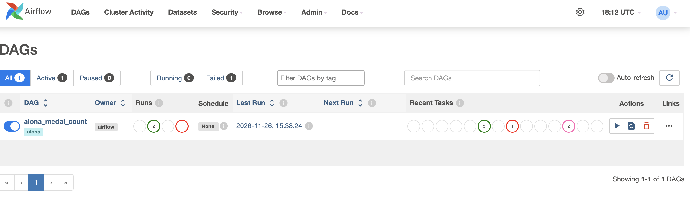
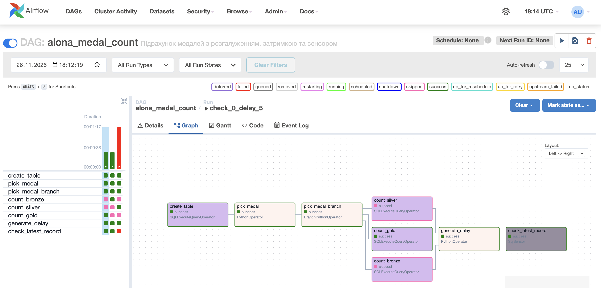
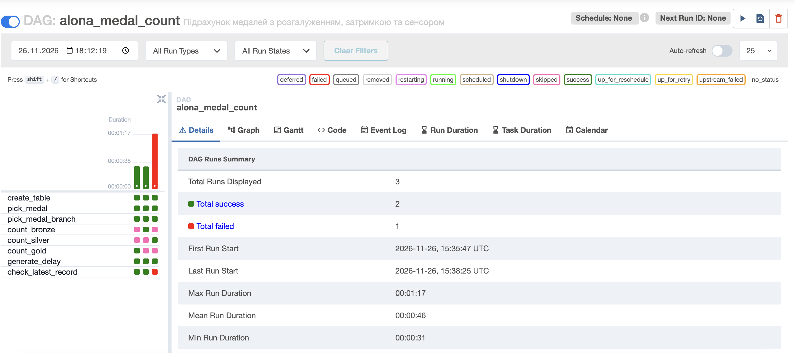
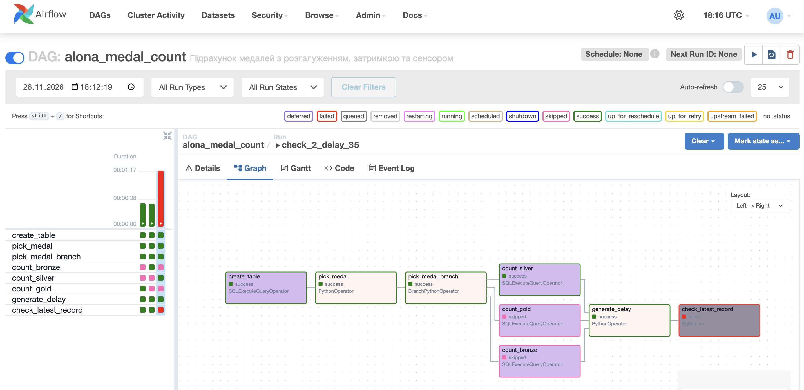
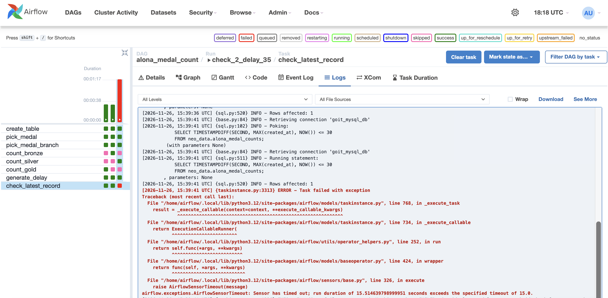
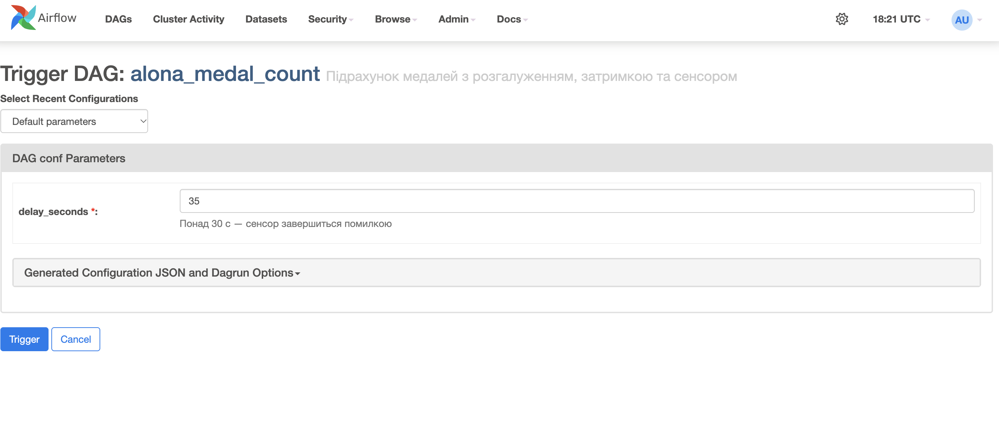
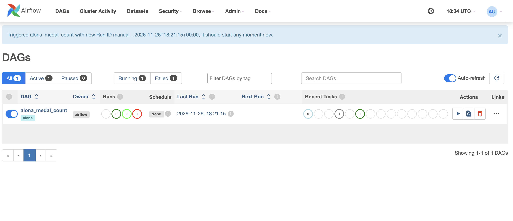
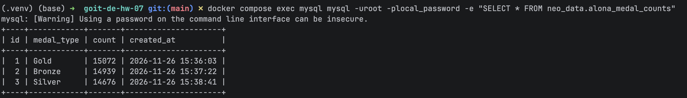

# goit-de-hw-07

Домашнє завдання з Apache Airflow: DAG, який випадково обирає тип медалі, рахує
відповідні записи в MySQL, робить затримку та перевіряє сенсором свіжість результату.

## Структура

| Файл | Призначення |
|---|---|
| `dags/medal_count_dag.py` | DAG `alona_medal_count` |
| `docker-compose.yml` | локальні Airflow 2.10.5, MySQL 8.4 та PostgreSQL (службова база Airflow) |
| `init_db/init.sql` | створення `olympic_dataset.athlete_event_results` та завантаження CSV |
| `scripts/download_data.sh` | завантаження датасету |

```
create_table → pick_medal → pick_medal_branch ┬→ count_bronze ┐
                                              ├→ count_silver ┼→ generate_delay → check_latest_record
                                              └→ count_gold   ┘
```

## Дані

Використано публічний датасет
[Olympic Historical Dataset from Olympedia.org](https://www.kaggle.com/datasets/josephcheng123456/olympic-historical-dataset-from-olympediaorg)
(Kaggle), файл `Olympic_Athlete_Event_Results.csv`, 316 834 записи. Це не копія бази з
сервера курсу, тому кількості можуть відрізнятися.

| medal | Кількість |
|---|---|
| Gold | 15072 |
| Silver | 14676 |
| Bronze | 14939 |

## Запуск

Потрібен Docker.

```
./scripts/download_data.sh
docker compose up -d
```

Airflow UI: http://localhost:8080 (перший запуск триває кілька хвилин). Користувач
`admin`, пароль:

```
docker compose exec airflow cat standalone_admin_password.txt
```

Увімкніть DAG `alona_medal_count` та запустіть його через **Trigger DAG**.

Переглянути таблицю з результатами:

```
docker compose exec mysql mysql -uroot -plocal_password -e "SELECT * FROM neo_data.alona_medal_counts"
```

Зупинка — `docker compose down` (з `-v` також видаляються дані баз).

## Виконання завдання

1. **`create_table`** створює таблицю `neo_data.alona_medal_counts` (`IF NOT EXISTS`) з
   полями `id`, `medal_type`, `count`, `created_at`.
2. **`pick_medal`** випадково обирає `Bronze`, `Silver` або `Gold`.
3. **`pick_medal_branch`** (`BranchPythonOperator`) запускає відповідну гілку, дві інші
   пропускаються.
4. **`count_bronze` / `count_silver` / `count_gold`** рахують записи з відповідною
   медаллю та додають тип, кількість і час створення в таблицю.
5. **`generate_delay`** (`PythonOperator`, `time.sleep`, `trigger_rule=ONE_SUCCESS`)
   затримує виконання. Тривалість задається параметром `delay_seconds` під час запуску
   (за замовчуванням 5 с).
6. **`check_latest_record`** (`SqlSensor`) перевіряє, що найновіший запис не старший за
   30 секунд. Перевірка кожні 5 с, тайм-аут 15 с.

Щоб побачити падіння сенсора, запустіть DAG з `delay_seconds = 35`. Для DAG встановлено
`max_active_runs=1`, щоб запис з паралельного запуску не приховав помилку.

## Скриншоти

### Список DAG

`alona_medal_count`: два успішні запуски та один невдалий.



### 1. Успішний запуск: розгалуження

Обрано гілку `count_gold`, дві інші пропущені (`skipped`), сенсор пройшов.



### 2. Усі запуски

Два успішні запуски із затримкою 5 с та один невдалий із затримкою 35 с. У кожному
запуску випадково обрано свою гілку.



### 3. Затримка 35 с: сенсор завершився помилкою



### 4. Лог сенсора

`AirflowSensorTimeout`: найновіший запис старший за 30 секунд.



### 5. Задання затримки під час запуску



Після натискання **Trigger** DAG запущено.



### 6. Таблиця з результатами


